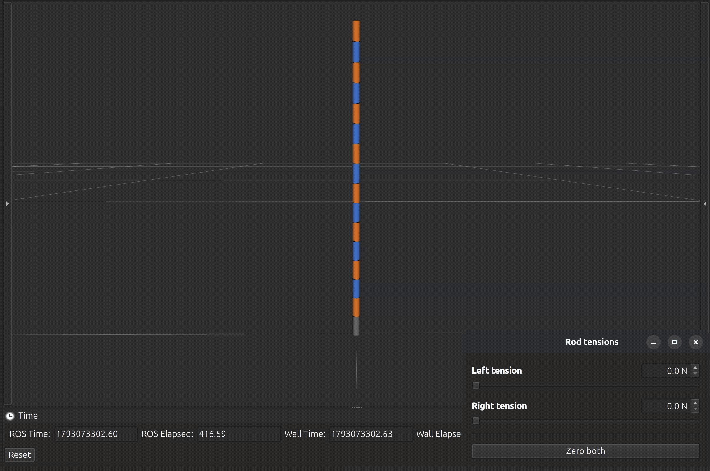
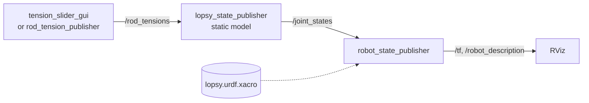

# Lopsy

**A rod-driven continuum robot with asymmetric rolling joints, and a ROS 2 model that predicts its shape from the tension in its rods.**

[](https://docs.ros.org)
[](src/lopsy_kinematics)
[](https://doi.org/10.1109/LRA.2025.3597860)

<p align="center">
  
</p>

## Why asymmetric

Continuum robots are slender and flexible, and that is also their weakness: they carry very little load. In a robot built from rolling joints, every joint is a lever. The rod pulls on one side, the link pivots about the point where it rolls on the link below, and the torque is the rod tension times the distance between the two. In a symmetric joint the pivot sits midway between the rods, so both rods get the same lever.

Lopsy moves the pivot off-centre. The underside of each link is two arcs of different radii that meet at a crest away from the middle. With the same rod spacing, the rod on the far side now pulls with a 3 mm lever instead of 2 mm, and the rod on the near side with 1 mm. Asymmetry doesn't add leverage; it moves it from one bending direction to the other: 50 % more torque per newton one way, half as much the other way, without making the robot any thicker.

That makes the asymmetric joint a tool for sections that mainly work in one direction. The prototype flips every other link instead, so that it can bend both ways. Its rods are superelastic NiTi rather than braided tendons: they are the actuators and also a flexible backbone, whose stiffness keeps the short-lever joints from buckling.

## Why it needs a model

The asymmetry also makes the robot hard to predict. Each joint switches between two rolling radii as it passes through straight, odd and even joints have different levers and bend by different amounts, friction drains the tension along the rods, and the rods stiffen every joint. The robot doesn't bend into a constant-curvature arc, so the usual constant-curvature model fails: in the [paper](https://doi.org/10.1109/LRA.2025.3597860) it was off by 11.5 %, against 2.25 % for a static model.

## What this repository does

It solves Lopsy's forward kinematics: give it the tension in each rod, and it computes all 15 joint angles, with friction, rod stiffness and both rods included, then shows the shape in RViz. Fitted to 70 measured shapes of the prototype, it reproduces them with a mean error of about 2 % (3.6 % from the raw force readings), measured as in the paper ([details](#model-parameters)). A solve takes tens of microseconds.

That makes it a base for what comes next: model-based control, estimating the shape from the motor's force reading, and design studies like the one above. The joint geometry is a set of parameters, and a symmetric robot is simply the case A1 = A2, R1 = R2.

The model is a corrected version of the one in the paper ([what changed](#model-notes)). The robot was originally designed to steer chest tubes from the inside; the paper covers that application.

## The robot

The prototype is one section of 15 rigid 3D-printed links, each 15 mm long and 6.2 mm across, stacked above a fixed base. Each link is flat on top. Its underside is two tangent arcs with radii $R_1$ and $R_2$, which meet at the crest, and the link rolls without slipping on the flat top of the link below, on whichever arc it tilts toward.

The rod holes sit $A_1 = 3$ mm and $A_2 = 1$ mm from the crest. Odd links have $A_1$ and $R_1$ on the left and even links on the right, so with the left rod pulled the odd joints bend about twice as much as the even ones. The two NiTi rods are fixed to the last link and pulled at the base by a Dynamixel motor and spool.

| | Nominal design |
|---|---|
| Links | 15 × 15 mm, 3D-printed PLA |
| Diameter | 6.2 mm |
| Arc radii $R_1$, $R_2$ | 6.7 mm, 2.275 mm |
| Hole offsets $A_1$, $A_2$ | 3 mm, 1 mm |
| Rods | 2 × superelastic NiTi, ⌀ 0.6 mm |
| Actuation | Dynamixel MX-64T and a spool at the base |

The model's defaults are identified values close to these (see [Model parameters](#model-parameters)).

**Left and right are fixed by the hardware.** The left rod is the one on the long-lever side of the odd links. Nothing is relabelled when the bending direction changes.

## Quick start

You need ROS 2 with RViz and colcon. Replace `<distro>` with your ROS distribution.

```bash
source /opt/ros/<distro>/setup.bash
git clone https://github.com/mmehdi98/lopsy_ws.git
cd lopsy_ws
rosdep install --from-paths src --ignore-src -y
sudo apt install ros-$ROS_DISTRO-xacro ros-$ROS_DISTRO-robot-state-publisher \
                 ros-$ROS_DISTRO-joint-state-publisher-gui ros-$ROS_DISTRO-rviz2
colcon build --symlink-install
source install/setup.bash
```

Then launch the robot:

```bash
ros2 launch lopsy_bringup lopsy.launch.xml
```

RViz opens with the robot, next to a **Rod tensions** window. Drag **Left tension** (0 to 50 N) to bend toward the left rod, **Right tension** to bend the other way, and press **Zero both** to straighten it. With the default parameters, 20 N on the left rod bends the section by about 97° in total. Most of it is at the odd joints, and the joints bend less toward the tip, where friction has eaten into the tension.

Other ways to run it:

| Command | What you get |
|---|---|
| `ros2 launch lopsy_bringup lopsy.launch.xml gui:=false` | No window. `rod_tension_publisher` holds 20 N on the left rod; change it with `ros2 param set /rod_tension_publisher left_tension 35.0` |
| `ros2 launch lopsy_bringup reconfigure.launch.xml` | The tensions as sliders in `rqt_reconfigure` (select `rod_tension_publisher` in its list) |
| `ros2 launch lopsy_description display.launch.xml` | The URDF alone, with `joint_state_publisher_gui` sliders for the 30 roll joints and no model |

Run `source install/setup.bash` in every new terminal.

## How it works

The model takes the tension in each rod at the base, $T^L_0$ and $T^R_0$, and returns the 15 joint angles $\theta_i$. An angle is positive when link $i$ tilts toward the left rod. Superscripts $l$ and $r$ mark the left and right side of a link: $A^l_i = A_1$ and $R^l_i = R_1$ on odd links, $A_2$ and $R_2$ on even ones. Superscripts $L$ and $R$ mark the two rods. Odd and even links share every equation; only these values swap.

**Joint range.** A joint can roll until its closing gap shuts, about ±29° per joint with the default geometry:

```math
\alpha_i = \arcsin\frac{A^l_i}{R^l_i}, \qquad \beta_i = \arcsin\frac{A^r_i}{R^r_i}, \qquad -\beta_i < \theta_i < \alpha_i \qquad \text{(C1)}
```

**Friction.** Each rod loses tension at every joint it wraps around. The capstan law gives the loss, with the wrap angle taken as $|\theta_i|$:

```math
T_i = T_{i-1}\,e^{-\mu|\theta_i|} \qquad \text{(C6)}
```

**Rod stiffness.** Across a joint, each rod bends into a circular arc and resists the rotation, and the moments of the two rods add. A rod's free length is the height $h$ of its gap, converted to arc length, plus a setback $\lambda_0$ into each hole where the rod is effectively clamped:

```math
s = h\,\frac{\theta_i}{\sin\theta_i} + 2\lambda_0, \qquad
M^{el}_i = EI\,\theta_i\left(\frac{1}{s^c_i} + \frac{1}{s^o_i}\right), \qquad
I = \frac{\pi r^4}{4} \qquad \text{(C17)}
```

Here $s^c_i$ belongs to the gap that closes and $s^o_i$ to the gap that opens. Their heights (C9) follow exactly from the geometry of the arc in contact.

**Joint balance.** Cut the robot at joint $i$ and take links $i$ to $n$, with the pieces of rod inside them, as one body. About the rolling contact point, only three loads have a moment: the two rod tensions at the cut and the rods' bending moment. The contact force acts at that point, and friction and the forces between rods and holes are internal. That leaves one equation per joint:

```math
M^{el}_i(\theta_i) = T^L_{i-1}\left(A^l_i - R_i\sin\theta_i\right) - T^R_{i-1}\left(A^r_i + R_i\sin\theta_i\right) \qquad \text{(C16)}
```

$R_i$ is the radius of the arc in contact: $R^l_i$ when $\theta_i \ge 0$ and $R^r_i$ otherwise (C4).

### Solving it

Joint $i$ depends on the joints below it only through the tensions $T_{i-1}$, and the residual of its balance is strictly increasing in $\theta_i$, so each joint has exactly one solution in its range. The solver works from the base to the tip: a bracketed Newton iteration for each joint, which converges in a few steps, then the capstan law for the tensions entering the next joint. There is no continuation and no branch to track, so every message is solved from scratch, in tens of microseconds. The published Python implementation of the original model took 23 ms per configuration.

Two details keep it robust:

- At $\theta_i = \alpha_i$ the left rod's lever arm $A^l_i - R^l_i\sin\alpha_i$ is exactly zero, so no tension can pull a joint past its range. The same holds for the right rod at $-\beta_i$.
- The rolling radius and the gap formulas switch arcs at $\theta = 0$. They are blended over ±0.2° so that Newton sees a smooth function.

### From angles to RViz

URDF has no rolling joint, so [`lopsy.urdf.xacro`](src/lopsy_description/urdf/lopsy.urdf.xacro) builds each one from four joints, two per arc: a prismatic joint that moves the link by $R\,\theta$ along the top of the link below, and a revolute joint about the arc's centre. The prismatic joints are `<mimic>` copies of the revolute ones. `j{i}_roll_l` carries $\theta_i$ when it is positive and `j{i}_roll_r` when it is negative, with the arc spans $\alpha_i$ and $\beta_i$ as limits. The model node publishes these 30 roll joints, and `robot_state_publisher` fills in the slides and broadcasts the transforms.

Positive angles bend the robot toward +x of `base_link`. Odd links are drawn orange and even links blue.

The URDF keeps its own copy of the link geometry, in the xacro properties at its top (`L`, `D`, `A1`, `A2`, `R1`, `R2`). RViz draws the links with those values, so keep them equal to the model's `geometry.*` parameters.

## Model notes

The thesis and the paper stay as published; corrections to the model live in this code. Compared with the paper:

- **One balance per joint.** The angles come from a balance on everything above each joint (C16), not from moment balances on single links. Where the rods press on each link no longer matters, and neither do the tangential contact forces between links. The solution is unique.
- **Friction.** The capstan wrap angle is $|\theta_i|$ instead of the angle from the three-point construction.
- **Rod stiffness.** Both rods resist bending, so their moments add. The gap heights are exact, and the free length includes the setback $\lambda_0$.
- **Both rods.** Both tensions enter the balance, so either rod, or both, can be pulled. With both taut, applying the capstan law to the second rod is an assumption.
- **No buckling without a load.** With no external load, every joint bends toward the pulled rod. The paper's model predicted a slight backward rotation of the even joints at low force, about −1.4°; the prototype showed little or none.

Assumptions and limits:

- Planar and static, with rigid links that roll without slipping and no external loads.
- Linear-elastic rods: $E$ is an equivalent bending modulus. The peak rod strain at full load is about 2 %.
- Loading only: friction always opposes the pull, so the hysteresis when the tension is released isn't modelled.
- Gravity isn't in the joint balance yet. The default parameters come from tests with the robot lying flat, where gravity doesn't act in the bending plane.
- Bending toward the right rod is the mirror image of the tested case and hasn't been checked against measurements.

## ROS interface



### `lopsy_state_publisher` (C++)

The model node. It solves each `RodTensions` message it receives and publishes the result as joint states.

- **Subscribes** to `/rod_tensions` (`lopsy_interfaces/msg/RodTensions`).
- **Publishes** `/joint_states` (`sensor_msgs/msg/JointState`): positions of `j1_roll_l`, `j1_roll_r`, …, `j15_roll_r`.
- **Parameters:** the [model parameters](#model-parameters), read once at start-up.

### `tension_slider_gui` (Python, Qt)

A window with a slider and a number box for each rod, in 0.1 N steps, and a **Zero both** button. It publishes `/rod_tensions` continuously.

| Parameter | Default | Meaning |
|---|---|---|
| `max_tension` | `50.0` | Slider range [N] |
| `left_tension`, `right_tension` | `0.0` | Starting values [N] |
| `publish_rate` | `20.0` | Publishing rate [Hz] |

### `rod_tension_publisher` (C++)

Publishes `/rod_tensions` at 20 Hz from two parameters, which can be changed while it runs with `ros2 param set` or the sliders in `rqt_reconfigure`.

| Parameter | Default | Range |
|---|---|---|
| `left_tension` | `20.0` | 0 to 50 N, in 0.1 N steps |
| `right_tension` | `0.0` | 0 to 50 N, in 0.1 N steps |

Give the parameters of both tension nodes as decimals (`20.0`, not `20`); the nodes reject integers.

### `lopsy_interfaces/msg/RodTensions`

```text
float64 left_tension
float64 right_tension
```

Rod tensions at the base, in newtons. Rods can't push, so negative values count as zero. Anything that publishes this message on `/rod_tensions` can drive the model, such as a controller or a motor driver. Stop the slider node first, since it publishes continuously.

### Model parameters

`lopsy_state_publisher` reads these once at start-up, in SI units. Override them in a launch file:

```xml
<node pkg="lopsy_kinematics" exec="lopsy_state_publisher">
    <param name="rods.mu" value="0.5"/>
</node>
```

or on the command line: `ros2 run lopsy_kinematics lopsy_state_publisher --ros-args -p rods.mu:=0.5`.

| Parameter | Default | Meaning |
|---|---|---|
| `n_links` | `15` | Number of links. Must match the URDF |
| `geometry.L` | `0.015` | Link length, crest to flat top [m] |
| `geometry.D` | `0.0062` | Link diameter [m]. Not used by the model |
| `geometry.A1` | `3.21e-3` | Larger hole-to-crest distance [m] |
| `geometry.A2` | `1.0e-3` | Smaller hole-to-crest distance [m] |
| `geometry.R1` | `6.45e-3` | Larger arc radius [m] |
| `geometry.R2` | `2.13e-3` | Smaller arc radius [m] |
| `rods.r` | `0.3e-3` | Rod radius [m] |
| `rods.E` | `61.0e9` | Equivalent bending modulus of the rods [Pa] |
| `rods.mu` | `0.66` | Effective rod-to-link friction coefficient |
| `rods.lambda0` | `2.2e-3` | Setback: how deep each rod is effectively clamped inside a hole [m] |

<details>
<summary>Gravity and solver settings</summary>

| Parameter | Default | Meaning |
|---|---|---|
| `gravity.G` | `0.0` | Weight of one link in the bending plane [N]. Reserved: not in the joint balance yet |
| `gravity.x_cg`, `gravity.y_cg` | `0.02e-3`, `7.35e-3` | Centre of gravity of a link [m] |
| `gravity.psi0` | `0.0` | Angle of the base axis from the upward vertical [rad] |
| `solver.blend_width` | `3.49e-3` | Half-width of the blend between the two arcs at θ = 0 [rad], i.e. 0.2° |
| `solver.abs_smoothing` | `1.0e-4` | Smoothing of the absolute value in the capstan law [rad] |
| `solver.bracket_margin` | `0.2` | How far the root bracket extends past the joint range [rad] |
| `solver.stop_stiffness` | `10.0` | Stiff stop past the joint limits, a numerical guard [N·m/rad] |
| `solver.angle_tolerance` | `1.0e-12` | Convergence tolerance on each angle [rad] |
| `solver.max_iterations` | `100` | Iteration cap per joint |

</details>

The defaults come from fitting the model to five loading runs of the prototype lying flat: 70 measured shapes, up to 48 N. The measured shapes were trusted over the motor's force reading, which comes in 0.94 N steps and is uncertain by about 5 % at high load. With the metric behind the paper's 2.25 % figure, the mean shape error is 1.9 % when each shape's force may move within that uncertainty. It is 3.6 % with the recorded forces, less a 2.8 N offset for slack and static friction.

A few things to know before changing them:

- $E$ and $\lambda_0$ trade off almost perfectly. The data fix the joint stiffness, and a prior near the NiTi modulus splits it between the two, so change them together.
- $E$ was identified with $r = 0.3$ mm. If you change $r$, scale $E$ so that $E r^4$ stays the same.
- $\mu$ is an effective coefficient: it also absorbs the $|\theta|$ approximation of the wrap angle, which is why it is high for NiTi on PLA.
- $A_2$ can't be identified from shape data, so it stays at its nominal 1 mm. Measure it on a printed link if you can.

## Code layout

```text
lopsy_ws/src/
├── lopsy_bringup/       launch files for the whole system
├── lopsy_description/   URDF (xacro), link mesh, RViz config, URDF-only launch
├── lopsy_interfaces/    RodTensions message
└── lopsy_kinematics/    static model, nodes, slider window, tests
    ├── include/lopsy_kinematics/
    ├── src/lib/         lopsy_model library (no ROS)
    ├── src/node/        lopsy_state_publisher, rod_tension_publisher
    ├── scripts/         tension_slider_gui.py
    └── test/
```

The model is a plain C++ library, `lopsy_model`, with no ROS dependency; the node only wraps it. It is split into layers:

| Header | What it does |
|---|---|
| `params.hpp` | Robot parameters and solver settings, in SI units |
| `link_geometry.hpp` | Per-link values: hole offsets, arc radii, joint limits, and the odd/even swap (C1–C3) |
| `mechanics.hpp` | One joint: rolling radius, gap heights, free length and elastic moment. Most functions also return their derivative, for Newton |
| `statics.hpp` | Joint balance, capstan law, the base-to-tip solve, and contact forces on demand |
| `model.hpp` | `ContinuumRobotModel`, which owns the parameters and the links and has a single `solve()` |
| `joint_state_mapping.hpp` | Maps the 15 model angles to the 30 URDF roll joints |

Comments in the source cite equations by label, such as (C16). The main ones are written out under [How it works](#how-it-works).

A solve, as the node does it:

```cpp
#include "lopsy_kinematics/model.hpp"

using namespace lopsy_kinematics;

const ContinuumRobotModel model;                          // default parameters
const State state = model.solve(RodTensions{20.0, 0.0});  // 20 N on the left rod

// state.theta[k]    angle of joint k+1 [rad], positive bends left
// state.tension[k]  rod tensions entering joint k+1 (tension[0] is the input)
// state.converged   true when every joint converged
```

A model never changes after it is built: to use other parameters, build a new one from a modified `RobotParams`. `contact_forces()` in `statics.hpp` returns the contact forces between links for a solved state. They are approximate, and the angles don't depend on them.

## Tests

```bash
colcon build --packages-select lopsy_kinematics
colcon test --packages-select lopsy_kinematics --ctest-args -R test_lopsy_model
colcon test-result --verbose
```

Drop `--ctest-args -R test_lopsy_model` to run the ament linters too. The GoogleTest suite checks:

- the link geometry and the odd/even swap;
- every analytic derivative against finite differences;
- that every joint satisfies its balance, stays inside its range for any tension, and loses tension by the capstan law;
- that pulling the right rod gives exactly the mirror image of pulling the left rod on a mirrored robot;
- that scaling tension and stiffness together leaves the angles unchanged;
- the contact forces, and the mapping to URDF joints.

## Citation

If you use this work, please cite the paper:

```bibtex
@article{lari2025rod,
  author  = {Lari, Mohammadmehdi and Russo, Matteo},
  title   = {Design, Modeling, and Experimental Characterization of a Rod-Driven Continuum Robot With Asymmetric Joints for Active Chest Catheters},
  journal = {IEEE Robotics and Automation Letters},
  year    = {2025},
  volume  = {10},
  number  = {10},
  pages   = {9766--9773},
  doi     = {10.1109/LRA.2025.3597860}
}
```

The robot and its first model come from the MSc thesis *Design and Experimental Characterization of a Continuum Robot for Active Chest Catheters* (M. Lari, University of Rome Tor Vergata, A.Y. 2023/2024, supervised by Prof. Matteo Russo). The thesis's Python model is in [multibackbone_asymmetric_continuum_robot](https://github.com/mmehdi98/multibackbone_asymmetric_continuum_robot).

## Author

Mehdi Lari · [@mmehdi98](https://github.com/mmehdi98)